# Checkers FSA logic

This is the target control FSA for the portable Checkers agent. Policy ranks
legal projected moves in the evaluation and selection states; it is not the
state machine itself.

```mermaid
stateDiagram-v2
    [*] --> q0

    state "q0: WAIT_REQUEST" as q0
    state "q1: SNAPSHOT_REQUEST" as q1
    state "q2: RECONCILE_RESULT" as q2
    state "q3: GENERATE" as q3
    state "q4: PROJECT" as q4
    state "q5: EVALUATE" as q5
    state "q6: SELECT" as q6
    state "q7: COMMIT_RESPONSE" as q7
    state "qE: COMMIT_ERROR" as qE
    state "q8: WAIT_RESULT" as q8

    q0 --> q1: committed request(seq)
    q1 --> qE: invalid protocol / stale seq
    q1 --> qE: invalid board
    q1 --> q2: valid snapshot

    q2 --> qE: prior result contradicts expected board
    q2 --> q3: result reconciled

    q3 --> qE: no legal moves / terminal state
    q3 --> q3: more pieces to scan
    q3 --> q4: candidate available

    q4 --> q4: project next candidate/line
    q4 --> q5: all projections complete

    q5 --> q5: evaluate next projection
    q5 --> q6: all candidates scored

    q6 --> q7: deterministic best move selected
    q7 --> q8: write move + diagnostic; READY last

    qE --> q8: write error; ERROR last
    q8 --> q0: response acknowledged; new sequence
```



## Initial state

```text
q0 = WAIT_REQUEST
```

## Input alphabet, Σ

The input alphabet is the set of normalized events the FSA accepts from its
mailbox adapter, rules engine, memory, and bounded projection work.

```text
Σ = {
  committed_request(seq),
  invalid_protocol(error),
  stale_sequence,
  valid_board,
  invalid_board,
  prior_result_matches,
  prior_result_mismatch,
  more_generation_work,
  candidate_available,
  no_legal_move,
  more_projection_work,
  projections_complete,
  more_evaluation_work,
  evaluations_complete,
  response_acknowledged,
  new_sequence
}
```

## Output alphabet, Γ

The output alphabet is intentionally separate from `Σ`. It is the observable
mailbox/trace result produced by the controller.

```text
Γ = {
  BUSY(seq),
  READY(seq, move, diagnostic),
  ERROR(seq, error_code),
  trace(phase, board_hash, candidate, score)
}
```

## Current implementation boundary

The portable core currently implements the `q0 → q1 → q2 → q7/qE → q8`
request/response skeleton. The rules module supplies the legal-move evidence
needed to implement `q3`. Projection, evaluation, and selection remain the
next FSA stages; they will be introduced only after the complete rules set is
fixture-tested.
